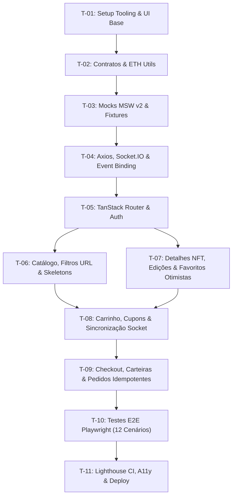

# Plano de Execução — NFT Marketplace Frontend Challenge

## 1. Arquitetura Proposta e Decisões de Stack

### Decisões Tecnológicas (Justificativa em 1 Linha)
- **Vite + React 19 + TypeScript**: Ferramenta de build ultrarrápida com compilação nativa ESM, compatibilidade estrita com React 19 e ecossistema moderno do JF.
- **TanStack Router v1 (File-Based Routing)**: Roteamento com tipagem estrita de rotas, loaders integrados e sincronização bidirecional de search params (filtros, busca e paginação na URL).
- **TanStack Query v5 (`@tanstack/react-query`)**: Gerenciamento de estado remoto declarativo, deduplicação de requisições, controle granular de staleTime/gcTime e suporte nativo a mutações otimistas com rollback.
- **Axios v1.x**: Cliente HTTP centralizado com interceptores para injeção de bearer token, cabeçalho `X-Idempotency-Key` e interceptação global de erros (401/409/500).
- **Socket.IO Client v4**: Cliente de WebSocket resiliente com suporte a eventos estruturados (`nft.updated`, `order.updated`), reconexão automática e controle de versões de mensagens.
- **MSW v2 (Mock Service Worker)**: Mocking declarativo na camada de rede (Service Worker no browser e interceptor no Node), garantindo que nem componentes nem Axios contenham código fake.
- **@mswjs/socket.io-binding**: Interceptor de rede para simular o protocolo Socket.IO no browser sem servidores externos, viabilizando testes determinísticos de tempo real.
- **Tailwind CSS v4 + shadcn/ui**: Utilitários atômicos de estilização combinados com primitivos acessíveis (Radix UI) para componentes responsivos e customizáveis.
- **Playwright Test**: Framework de automação E2E multi-viewport (Chromium Desktop 1440px, Tablet 768px, Mobile 390px) com suporte a regressão visual (`toHaveScreenshot`) e isolamento de cenários.
- **Lighthouse CI (`@lhci/cli`)**: Automação de auditoria com regras estritas para Performance (≥90), Acessibilidade (≥95), Boas Práticas (≥95) e SEO (≥90).
- **React Hook Form + Zod**: Gerenciamento performático de formulários desacoplado de re-renders desnecessários e validação com schemas compartilhados de domínio.

### Decisão de Design e Figma
O Figma é a referência obrigatória. O acesso automatizado não foi possível nesta revisão; isso não autoriza substituir sua identidade visual. Antes de finalizar as telas, inventariar frames desktop/mobile, tokens, fontes e assets, exportando os recursos para execução local. A base visual existente é provisória e não comprova fidelidade. Campos definitivos de checkout e perfil dependem dessa inspeção.

### Estado desta etapa
Planejamento revisado em três frentes: requisitos, arquitetura e etapas. O escopo de implementação inicial é configuração executável e demonstração de componentes, sem fluxos comerciais. Regras detalhadas e plano de paralelismo em [complemento-planejamento.md](complemento-planejamento.md); esse complemento prevalece sobre os esboços de interfaces abaixo.

### Estrutura de Pastas Proposta
```
nft-marketplace-test/
├── docs/
│   ├── enunciado.md
│   ├── complemento-planejamento.md
│   └── contratos.md
├── e2e/
│   ├── fixtures/
│   │   ├── auth.fixture.ts
│   │   └── mock-state.fixture.ts
│   ├── catalog.spec.ts
│   ├── nft-detail.spec.ts
│   ├── cart.spec.ts
│   ├── checkout-order.spec.ts
│   ├── realtime-socket.spec.ts
│   ├── auth-profile.spec.ts
│   └── visual-regression.spec.ts
├── lighthouserc.json
├── playwright.config.ts
├── vite.config.ts
├── package.json
├── src/
│   ├── app/
│   │   ├── main.tsx                  # Ponto de entrada, inicialização do MSW
│   │   ├── router.tsx                # Instância do createRouter
│   │   └── providers.tsx             # QueryClientProvider, AuthProvider, TooltipProvider
│   ├── routes/
│   │   ├── __root.tsx                # Shell da aplicação (Header, Footer, Modais)
│   │   ├── index.tsx                 # Catálogo, Hero, Filtros, Busca
│   │   ├── nft.$id.tsx               # Detalhes do NFT e edições
│   │   ├── cart.tsx                  # Tela de carrinho dedicado (ou drawer compartilhado)
│   │   ├── checkout.tsx              # Pagamento, revisão e seleção de carteira
│   │   ├── order.confirmation.$id.tsx# Confirmação e snapshot do recibo
│   │   ├── auth/
│   │   │   ├── login.tsx             # Login de usuário
│   │   │   └── register.tsx          # Cadastro de colecionador
│   │   ├── profile.tsx               # Dados do usuário, avatar e senha
│   │   └── wallets.tsx               # Gerenciamento de carteiras
│   ├── domain/
│   │   ├── auth.ts                   # Interfaces User, Session, Token
│   │   ├── nft.ts                    # Interfaces NFT, NFTDetail, Edition, Filters
│   │   ├── cart.ts                   # Interfaces CartItem, Cart
│   │   ├── quote.ts                  # Interfaces Quote, Coupon, Fees
│   │   ├── order.ts                  # Interfaces Order, OrderReceipt, OrderStatus
│   │   ├── wallet.ts                 # Interfaces Wallet, WalletNetwork
│   │   └── events.ts                 # Interfaces NftUpdatedEvent, OrderUpdatedEvent
│   ├── api/
│   │   ├── client.ts                 # Instância Axios com baseURL e interceptores
│   │   ├── auth.api.ts               # Chamadas REST de autenticação
│   │   ├── nfts.api.ts               # Listagem, busca e detalhes
│   │   ├── cart.api.ts               # Operações do carrinho
│   │   ├── quote.api.ts              # Cotação e validação de cupom
│   │   ├── orders.api.ts             # Pedidos idempotentes e recibos
│   │   ├── profile.api.ts            # Perfil do colecionador
│   │   └── wallets.api.ts            # Gestão de carteiras
│   ├── lib/
│   │   ├── axios.ts                  # Configuração global do Axios
│   │   ├── socket.ts                 # Instância do socket.io-client e wrappers tipados
│   │   ├── eth.ts                    # Precisão decimal de ETH (operações e formatação)
│   │   ├── utils.ts                  # Utilitário cn (clsx + twMerge)
│   │   └── storage.ts                # Wrapper de localStorage seguro
│   ├── contexts/
│   │   └── auth-context.tsx          # Estado de autenticação da sessão ativa
│   ├── features/
│   │   ├── catalog/
│   │   │   ├── components/           # NftCard, NftFilters, NftGrid, NftSort
│   │   │   ├── hooks/                # useNftsQuery, useNftFilters
│   │   │   └── schemas/              # catalogFiltersSchema (Zod)
│   │   ├── nft-detail/
│   │   │   ├── components/           # NftGallery, NftMetadata, EditionSelector, BuyBox
│   │   │   └── hooks/                # useNftDetailQuery, useToggleFavoriteMutation
│   │   ├── cart/
│   │   │   ├── components/           # CartDrawer, CartItemList, CartSummary, CouponInput
│   │   │   └── hooks/                # useCartQuery, useCartMutations, useQuoteQuery
│   │   ├── checkout/
│   │   │   ├── components/           # WalletSelector, NetworkSelector, OrderReview, PaymentStatusModal
│   │   │   ├── hooks/                # useCreateOrderMutation, useOrderPolling
│   │   │   └── schemas/              # checkoutFormSchema (Zod)
│   │   ├── profile/
│   │   │   ├── components/           # ProfileForm, PasswordForm, AvatarUpload
│   │   │   └── hooks/                # useProfileQuery, useUpdateProfileMutation
│   │   └── wallets/
│   │       ├── components/           # WalletList, AddWalletDialog, WalletCard
│   │       └── hooks/                # useWalletsQuery, useWalletMutations
│   ├── components/
│   │   ├── ui/                       # Primitivos shadcn/ui: button, dialog, input, etc.
│   │   ├── layout/                   # Header, Footer, MobileNav, UserMenu, CartTrigger
│   │   └── feedback/                 # ErrorState, EmptyState, ShimmerCardSkeleton, NetworkBanner
│   └── mocks/
│       ├── browser.ts                # Inicialização do Service Worker MSW
│       ├── node.ts                   # Inicialização do setupServer para testes
│       ├── db.ts                     # Estado em memória com seeds determinísticos
│       ├── socket.ts                 # Emissor de eventos Socket.IO mock (@mswjs/socket.io-binding)
│       └── handlers/
│           ├── auth.handlers.ts
│           ├── nfts.handlers.ts
│           ├── cart.handlers.ts
│           ├── quote.handlers.ts
│           ├── orders.handlers.ts
│           ├── profile.handlers.ts
│           └── wallets.handlers.ts
```

---

## 2. Contratos REST Tipados

### Tipos e Interfaces de Domínio (`src/domain/`)

```typescript
// src/domain/common.ts
export type EthDecimalString = string; // Ex: "0.4500", "1.2500" - preserva precisão sem erros flutuantes IEEE 754

export interface ApiErrorResponse {
  statusCode: number;
  message: string;
  code: 'VALIDATION_ERROR' | 'UNAUTHORIZED' | 'FORBIDDEN' | 'NOT_FOUND' | 'OUT_OF_STOCK' | 'PRICE_CHANGED' | 'IDEMPOTENCY_CONFLICT' | 'INTERNAL_ERROR';
  details?: Record<string, string[]>;
}

// src/domain/auth.ts
export interface User {
  id: string;
  name: string;
  email: string;
  avatarUrl?: string;
  bio?: string;
  createdAt: string;
}

export interface SessionResponse {
  user: User;
  token: string;
  expiresAt: string;
}

// src/domain/nft.ts
export interface Edition {
  id: string;
  editionNumber: number;
  totalEditions: number;
  priceEth: EthDecimalString;
  availableQuantity: number;
  isAvailable: boolean;
}

export interface NFT {
  id: string;
  title: string;
  description: string;
  imageUrl: string;
  creator: {
    id: string;
    name: string;
    avatarUrl: string;
  };
  collection: string;
  category: 'art' | 'gaming' | 'music' | 'photography' | 'collectibles';
  priceEth: EthDecimalString;
  isFavorite: boolean; // Apenas resposta privada de favoritos; nunca no NFT público.
  version: number; // Controle de versão para concorrência e Socket.IO
  createdAt: string;
}

export interface NFTDetail extends NFT {
  editions: Edition[];
  attributes: { trait_type: string; value: string }[];
  contractAddress: string;
  tokenId: string;
  tokenStandard: 'ERC-721' | 'ERC-1155';
}

export interface NFTFilterParams {
  search?: string;
  category?: string;
  minPrice?: string;
  maxPrice?: string;
  sortBy?: 'price_asc' | 'price_desc' | 'rarity' | 'recent';
  page?: number;
  limit?: number;
}

export interface NFTListResponse {
  items: NFT[];
  total: number;
  page: number;
  limit: number;
  totalPages: number;
}

// src/domain/favorites.ts
export interface FavoriteResponse {
  nftId: string;
  isFavorite: boolean; // Apenas resposta privada de favoritos; nunca no NFT público.
}

// src/domain/cart.ts
export interface CartItem {
  id: string;
  nftId: string;
  editionId: string;
  nftTitle: string;
  imageUrl: string;
  unitPriceEth: EthDecimalString;
  quantity: number;
  maxAvailable: number;
}

export interface CartResponse {
  items: CartItem[];
  itemCount: number;
  updatedAt: string;
}

// src/domain/quote.ts
export interface QuoteRequest {
  items: {
    nftId: string;
    editionId: string;
    quantity: number;
  }[];
  couponCode?: string;
  walletNetwork?: string;
}

export interface QuoteResponse {
  quoteId: string;
  subtotalEth: EthDecimalString;
  discountEth: EthDecimalString;
  networkFeeEth: EthDecimalString;
  totalEth: EthDecimalString;
  couponApplied?: {
    code: string;
    discountPercent: number;
    isValid: boolean;
  };
  expiresAt: string; // Cotação expira em X segundos
}

// src/domain/order.ts
export type OrderStatus = 'pending' | 'confirmed' | 'rejected';

export interface OrderItemSnapshot {
  nftId: string;
  editionId: string;
  title: string;
  unitPriceEth: EthDecimalString;
  quantity: number;
  subtotalEth: EthDecimalString;
}

export interface OrderReceipt {
  id: string;
  idempotencyKey: string;
  userId: string;
  status: OrderStatus;
  failureReason?: string;
  items: OrderItemSnapshot[];
  subtotalEth: EthDecimalString;
  discountEth: EthDecimalString;
  networkFeeEth: EthDecimalString;
  totalEth: EthDecimalString;
  walletAddress: string;
  network: string;
  transactionHash?: string;
  createdAt: string;
  confirmedAt?: string;
}

export interface CreateOrderRequest {
  quoteId: string;
  walletAddress: string;
  network: string;
  items: {
    nftId: string;
    editionId: string;
    quantity: number;
  }[];
}

// src/domain/wallet.ts
export interface Wallet {
  id: string;
  userId: string;
  label: string;
  address: string;
  network: 'Ethereum' | 'Polygon' | 'Arbitrum';
  isPrimary: boolean;
  createdAt: string;
}

// src/domain/events.ts
export interface NftUpdatedEvent {
  eventId: string;
  nftId: string;
  editionId: string;
  type: 'nft.updated';
  id: string;
  version: number;
  priceEth: EthDecimalString;
  availableQuantity: number;
  isAvailable: boolean;
  timestamp: string;
}

export interface OrderUpdatedEvent {
  eventId: string;
  userId: string;
  version: number;
  type: 'order.updated';
  orderId: string;
  idempotencyKey: string;
  status: OrderStatus;
  failureReason?: string;
  transactionHash?: string;
  timestamp: string;
}
```

### Endpoints REST Mapeados
| Método | Endpoint | Request Body / Query | Resposta de Sucesso | Erros Mapeados |
|---|---|---|---|---|
| `POST` | `/api/auth/register` | `{ name, email, password }` | `SessionResponse` (201) | 400 (Zod), 409 (Email em uso) |
| `POST` | `/api/auth/login` | `{ email, password }` | `SessionResponse` (200) | 400, 401 (Credenciais inválidas) |
| `GET` | `/api/auth/me` | Header `Authorization` | `{ user: User }` (200) | 401 (Token expirado ou ausente) |
| `POST` | `/api/auth/logout` | Header `Authorization` | `{ success: true }` (200) | 200 (Idempotente) |
| `GET` | `/api/nfts` | `NFTFilterParams` na query string | `NFTListResponse` (200) | 400 (Parâmetros inválidos) |
| `GET` | `/api/nfts/:id` | Parâmetro de rota `:id` | `NFTDetail` (200) | 404 (NFT inexistente) |
| `GET` | `/api/favorites` | Header `Authorization` | `{ nftIds: string[] }` (200) | 401 |
| `POST` | `/api/favorites/:id` | Parâmetro `:id` | `FavoriteResponse` (200) | 401, 404 |
| `DELETE` | `/api/favorites/:id` | Parâmetro `:id` | `FavoriteResponse` (200) | 401, 404 |
| `GET` | `/api/cart` | Header `Authorization` (ou guestId) | `CartResponse` (200) | 200 |
| `POST` | `/api/cart/items` | `{ nftId, editionId, quantity }` | `CartResponse` (200) | 400, 404, 409 (Esgotado) |
| `PATCH` | `/api/cart/items/:itemId`| `{ quantity }` | `CartResponse` (200) | 400, 409 (Limite excedido) |
| `DELETE`| `/api/cart/items/:itemId`| Parâmetro `:itemId` | `CartResponse` (200) | 404 |
| `POST` | `/api/quote` | `QuoteRequest` | `QuoteResponse` (200) | 400, 422 (Cupom inválido/expirado) |
| `POST` | `/api/orders` | Header `X-Idempotency-Key`, `CreateOrderRequest` | `OrderReceipt` (201 ou 200 idempotente) | 400, 401, 409 (Conflito de payload na mesma chave), 422 (Preço mudou / esgotado) |
| `GET` | `/api/orders/:id` | Parâmetro `:id` | `OrderReceipt` (200) | 401, 404 |
| `GET` | `/api/profile` | Header `Authorization` | `User` (200) | 401 |
| `PATCH` | `/api/profile` | `{ name?, avatarUrl?, bio? }` | `User` (200) | 400, 401 |
| `POST` | `/api/profile/change-password` | `{ currentPassword, newPassword }` | `{ success: true }` (200) | 400, 401 |
| `GET` | `/api/wallets` | Header `Authorization` | `Wallet[]` (200) | 401 |
| `POST` | `/api/wallets` | `{ label, address, network, isPrimary }` | `Wallet` (201) | 400, 401 |
| `PATCH` | `/api/wallets/:id` | `{ label?, isPrimary? }` | `Wallet` (200) | 401, 404 |

---

## 3. Modelo de Estado e Políticas de Cache

### Onde Vive Cada Estado
1. **URL State (Search Params via TanStack Router)**:
   - Parâmetros: `q` (busca textual), `category`, `minPrice`, `maxPrice`, `sortBy`, `page`.
   - *Por quê*: Sobrevive a refresh, permite compartilhamento direto de links e suporta navegação pelo histórico do navegador (botões voltar/avançar). A alteração de qualquer filtro redefine automaticamente `page=1`.
2. **Remote Cache (TanStack Query v5)**:
   - `['nfts', filters]`: Cache de catálogo. `staleTime: 30_000` (30s), `gcTime: 300_000` (5min).
   - `['nft', id]`: Detalhe do NFT. `staleTime: 30_000`.
   - `['favorites', userId]`: Lista de IDs favoritos. Atualização otimista com rollback instantâneo se a mutation falhar.
   - `['cart', ownerId]` e `['quote', userId, cartRevision, items, coupon, network]`: Estado do carrinho e cotação. `staleTime: 0` (ou 10s) para garantir que sempre consulte a cotação fresca antes de submeter o checkout.
   - `['order', userId, orderId]`: Snapshot de pedido. Imutável após finalizado; `refetchInterval: 1500` enquanto `status === 'pending'`.
   - `['wallets', userId]` e `['profile', userId]`: `staleTime: 120_000` (2min).
3. **Local UI State (React State / React Hook Form)**:
   - Estado de digitação de inputs não submetidos, abertura de diálogos, drawers de mobile e modais de carteira.
4. **LocalStorage**:
   - `auth_token`: Token JWT simulado para reconstrução de sessão após refresh.
   - `guest_cart`: Itens do carrinho adicionados por usuário anônimo. No login bem-sucedido, esses itens são mesclados na API e a chave local é limpa.

### Política de Invalidação e Reconciliação Tempo Real (Socket.IO)
- **Evento `nft.updated`**:
  - Compara a versão recebida no evento com a versão em cache (`event.version > current.version`).
  - Atualiza o cache de `['nft', event.id]` diretamente e invalida `['nfts']`.
  - Se o NFT atualizado estiver presente no carrinho atual:
    - Invalida `['cart', ownerId]` e `['quote']`.
    - Dispara um alerta acessível no Drawer/Checkout informando alteração de preço ou esgotamento.
    - Se a tela estiver no checkout, invalida o `quoteId` e exige que o usuário clique em "Revisar e Aceitar Nova Cotação" antes de submeter o pedido.
- **Evento `order.updated`**:
  - Atualiza o registro em `['order', event.orderId]`.
  - Se status for `confirmed`, remove os itens comprados do carrinho (`queryClient.invalidateQueries({ queryKey: ['cart', ownerId] })`).
- **Limpeza de Sessão (Logout)**:
  - Invoca `queryClient.clear()` para descarregar dados privados da memória.
  - Remove `auth_token` e desconecta o cliente Socket.IO, evitando que o próximo usuário receba eventos ou veja dados residuais da sessão anterior.

---

## 4. Backlog de referência (dependências e subdivisões no complemento)



### T-01: Setup do Projeto, Tooling & Design System Base
- **Arquivos/Pastas**: `package.json`, `vite.config.ts`, `tsconfig.json`, `index.html`, `src/index.css`, `src/lib/utils.ts`, `src/components/ui/` (`button.tsx`, `input.tsx`, `badge.tsx`, `dialog.tsx`, `skeleton.tsx`, `drawer.tsx`, `dropdown-menu.tsx`, `toast.tsx`).
- **Critério de Pronto**: Executar `npm run build` e `npm run lint` sem erros; página de teste simples renderiza botões, badges e skeletons estilizados com Tailwind CSS e shadcn/ui.
- **Dependência**: Nenhuma (bloqueante para todas as tarefas subsequentes).

### T-02: Definição dos Contratos de Domínio & Utilitários de Precisão Decimal ETH
- **Arquivos/Pastas**: `src/domain/common.ts`, `src/domain/auth.ts`, `src/domain/nft.ts`, `src/domain/cart.ts`, `src/domain/quote.ts`, `src/domain/order.ts`, `src/domain/wallet.ts`, `src/domain/events.ts`, `src/lib/eth.ts`, `src/lib/eth.test.ts`.
- **Critério de Pronto**: Testes unitários com Vitest (`npx vitest run src/lib/eth.test.ts`) passando 100%, validando adição, subtração, formatação e aplicação de desconto percentual em strings decimais de ETH sem imprecisão binária.
- **Dependência**: T-01.

### T-03: Camada de Mocking MSW v2, Fixtures e Banco em Memória com Reset
- **Arquivos/Pastas**: `src/mocks/browser.ts`, `src/mocks/node.ts`, `src/mocks/db.ts`, `src/mocks/handlers/auth.handlers.ts`, `src/mocks/handlers/nfts.handlers.ts`, `src/mocks/handlers/cart.handlers.ts`, `src/mocks/handlers/quote.handlers.ts`, `src/mocks/handlers/orders.handlers.ts`, `src/mocks/handlers/profile.handlers.ts`, `src/mocks/handlers/wallets.handlers.ts`, `src/mocks/handlers/index.ts`.
- **Critério de Pronto**: MSW registrado com sucesso no navegador; handlers interceptam `/api/*`; fixture determinística com 2 usuários pré-cadastrados, pelo menos 16 NFTs com edições, cupons (`DESC10`, `EXPIRED`), e função `resetMockDb()` para isolamento de testes.
- **Dependência**: T-02.

### T-04: Cliente HTTP Axios, Cliente Socket.IO e Mock de Eventos Tempo Real
- **Arquivos/Pastas**: `src/lib/axios.ts`, `src/lib/socket.ts`, `src/mocks/socket.ts`, `src/api/client.ts`, `src/api/*.api.ts`.
- **Critério de Pronto**: Interceptor do Axios insere token de autorização e cabeçalho `X-Idempotency-Key`; socket conecta via `@mswjs/socket.io-binding`; teste de integração comprova recebimento de `nft.updated` e `order.updated` simulados via MSW.
- **Dependência**: T-03.

### T-05: Roteamento TanStack Router & Autenticação (Login, Cadastro, Persistência e Logout)
- **Arquivos/Pastas**: `src/app/router.tsx`, `src/app/providers.tsx`, `src/routes/__root.tsx`, `src/routes/auth/login.tsx`, `src/routes/auth/register.tsx`, `src/contexts/auth-context.tsx`, `src/components/layout/Header.tsx`, `src/components/layout/Footer.tsx`.
- **Critério de Pronto**: Fluxos de login e cadastro funcionam com validação Zod; token JWT simulado no localStorage; refresh mantém usuário autenticado; logout remove token, limpa cache do TanStack Query e redireciona rotas protegidas para `/auth/login`.
- **Dependência**: T-04.

### T-06: Catálogo de NFTs, Filtros na URL, Busca, Paginação e Skeletons Shimmer
- **Arquivos/Pastas**: `src/routes/index.tsx`, `src/features/catalog/components/NftCard.tsx`, `src/features/catalog/components/NftFilters.tsx`, `src/features/catalog/components/NftGrid.tsx`, `src/features/catalog/components/NftSort.tsx`, `src/features/catalog/hooks/useNftsQuery.ts`, `src/components/feedback/ShimmerCardSkeleton.tsx`, `src/components/feedback/EmptyState.tsx`, `src/components/feedback/ErrorState.tsx`.
- **Critério de Pronto**: Busca, categorias, faixa de preço e ordenação sincronizam estritamente com os query params da URL via TanStack Router; alteração de filtro reseta a página; transição exibe skeletons sem pulo de layout (Zero CLS); estados de erro possuem retry.
- **Dependência**: T-05.

### T-07: Detalhes do NFT, Seleção de Edições, Compra Direta e Favoritos com Atualização Otimista
- **Arquivos/Pastas**: `src/routes/nft.$id.tsx`, `src/features/nft-detail/components/NftGallery.tsx`, `src/features/nft-detail/components/NftMetadata.tsx`, `src/features/nft-detail/components/EditionSelector.tsx`, `src/features/nft-detail/components/BuyBox.tsx`, `src/features/nft-detail/hooks/useNftDetailQuery.ts`, `src/features/nft-detail/hooks/useToggleFavoriteMutation.ts`.
- **Critério de Pronto**: Acesso direto à URL `/nft/:id` carrega os dados; ID inválido exibe 404 amigável; clique em favorito alterna visualmente em 0ms (optimistic update) e faz rollback se a API retornar erro; seletor de edições respeita quantidade máxima disponível.
- **Dependência**: T-05 (pode ser desenvolvida em paralelo com T-06).

### T-08: Carrinho de NFTs, Cupons de Desconto, Cotação e Sincronização em Tempo Real
- **Arquivos/Pastas**: `src/routes/cart.tsx`, `src/features/cart/components/CartDrawer.tsx`, `src/features/cart/components/CartItemList.tsx`, `src/features/cart/components/CartSummary.tsx`, `src/features/cart/components/CouponInput.tsx`, `src/features/cart/hooks/useCartQuery.ts`, `src/features/cart/hooks/useCartMutations.ts`, `src/features/cart/hooks/useQuoteQuery.ts`.
- **Critério de Pronto**: Carrinho de visitante é preservado e migrado após login; alteração de quantidade recalcula subtotal e taxas; cupom inválido/expirado exibe mensagem de erro da API; ao receber evento Socket.IO `nft.updated` com alteração de preço de item no carrinho, exibe toast de aviso e atualiza o resumo sem crash.
- **Dependência**: T-06 e T-07.

### T-09: Checkout, Simulação de Carteiras/Rede, Pedidos Idempotentes e Confirmação
- **Arquivos/Pastas**: `src/routes/checkout.tsx`, `src/routes/order.confirmation.$id.tsx`, `src/routes/wallets.tsx`, `src/routes/profile.tsx`, `src/features/checkout/components/WalletSelector.tsx`, `src/features/checkout/components/NetworkSelector.tsx`, `src/features/checkout/components/OrderReview.tsx`, `src/features/checkout/components/PaymentStatusModal.tsx`, `src/features/checkout/hooks/useCreateOrderMutation.ts`, `src/features/wallets/`, `src/features/profile/`.
- **Critério de Pronto**: Formulário valida seleção de carteira e rede; envio gera `X-Idempotency-Key` (UUID); múltiplos cliques não duplicam o pedido (retornam o mesmo pedido); lida com status `pending`, `confirmed` e `rejected`; após confirmação, somente as quantidades compradas são descontadas uma única vez nos handlers e recibo imutável é renderizado.
- **Dependência**: T-08.

### T-10: Testes E2E Completos com Playwright (12 Cenários Obrigatórios) e Regressão Visual
- **Arquivos/Pastas**: `playwright.config.ts`, `e2e/fixtures/`, `e2e/catalog.spec.ts`, `e2e/nft-detail.spec.ts`, `e2e/cart.spec.ts`, `e2e/checkout-order.spec.ts`, `e2e/realtime-socket.spec.ts`, `e2e/auth-profile.spec.ts`, `e2e/visual-regression.spec.ts`.
- **Critério de Pronto**: Executar `npx playwright test` e validar 100% dos testes passando nos viewports Desktop (1440px) e Mobile (390px); snapshots de regressão visual salvos e estáveis; relatório HTML gerado.
- **Dependência**: T-09.

### T-11: Auditoria Lighthouse CI, Acessibilidade WCAG e Setup de Deploy
- **Arquivos/Pastas**: `lighthouserc.json`, `.github/workflows/ci.yml`, `ARCHITECTURE.md`, `README.md`, `vercel.json`.
- **Critério de Pronto**: `npm run audit:lh` reporta pontuações medianas: Performance ≥ 90, Accessibility ≥ 95, Best Practices ≥ 95, SEO ≥ 90; navegação por teclado e foco em modais/drawers sem armadilhas; README com instruções de setup e credenciais fictícias; deploy configurado para Vercel.
- **Dependência**: T-10.

---

## 5. Riscos Eliminatórios do Enunciado e Mitigações

| Item Eliminatório | Risco Identificado | Estratégia de Mitigação | Tarefa Responsável |
|---|---|---|---|
| **Ausência da stack obrigatória** | Uso de rotas tradicionais (React Router) ou mock in-memory solto sem MSW | Configurar TanStack Router com arquivos de rota estritos e Axios com MSW desde a base | T-01, T-04, T-05 |
| **Eventos simulados na UI** | Disparar mutações ou mudar estados via `setTimeout` dentro do componente | Eventos de tempo real são gerados estritamente pelo MSW Socket.IO binding e consumidos pelo `socket.io-client` oficial | T-04, T-08 |
| **Compra sem resposta da simulação** | Finalizar checkout otimista sem aguardar retorno de confirmação do backend | State machine de checkout: `idle` -> `submitting` -> `pending` -> `confirmed/rejected`. Confirmação só renderiza com snapshot retornado pela API | T-09 |
| **Exposição de dados entre usuários** | Troca de conta ou logout manter dados do usuário anterior no cache | Função de logout limpa `localStorage`, invoca `queryClient.clear()` e desconecta sockets | T-05 |
| **Ausência de testes E2E executáveis** | Testes Playwright falharem em ambiente de avaliação isolado | Playwright configurado com `webServer` apontando para o build de `preview` contendo o MSW Browser Worker | T-10 |

---

## 6. Execução em etapas e trabalho paralelo

A sequência operacional revisada está no complemento. Não iniciar uma tarefa junto de uma dependência ainda não concluída. Antes das features, estabilizar contratos, bootstrap, mocks e roteador; testar transporte real do cliente Socket.IO no build de preview. Cada trilha recebe arquivos exclusivos e testes próprios; contratos, registro de handlers, estilos globais, roteador e lockfile têm dono único. Nenhum agente deve fazer merge, push ou rebase automaticamente.

Commits iniciais pequenos: documentação; configuração e lockfile; componentes e preview. Depois, commits por feature ou incremento verificável, com os respectivos testes. Não misturar features incompletas para produzir um commit grande.

## 7. Verificação e Critérios de Aceite Globais
- **Lint e Tipagem**: `npm run lint`, `npm run typecheck`, `npm test` e `npm run build`.
- **Testes Unitários**: `npm run test` (testes de utilitários de ETH e schemas Zod).
- **Testes E2E**: `npm run test:e2e` (execução dos 12 cenários em Chromium Desktop e Mobile via Playwright).
- **Auditoria**: `npm run audit:lh` (Lighthouse CI medindo mediana de 3 execuções em Home e Detalhe).
